<h1 align="center">ceny-nieruchomości-mcp 🏠</h1>

<p align="center">
  <b>Prawdziwe ceny transakcyjne mieszkań, domów i działek w Polsce – dla Twojego asystenta AI.</b><br>
  Serwer <a href="https://modelcontextprotocol.io">MCP</a> z danymi z aktów notarialnych (Rejestr Cen Nieruchomości, GUGiK) – nie z ogłoszeń. Działa w Claude, ChatGPT, Cursorze i każdym kliencie MCP.
</p>

<p align="center">
  <a href="https://www.npmjs.com/package/ceny-nieruchomosci-mcp"></a>
  <a href="https://github.com/ContentWriterco/ceny-nieruchomosci-mcp/actions/workflows/ci.yml"></a>
  <a href="LICENSE"></a>
  
</p>

<p align="center">
  
</p>
<p align="center"><sub>Prawdziwa odpowiedź publicznego serwera (228 aktów notarialnych w promieniu 500 m, październik 2026).</sub></p>

## Podłącz w 30 sekund

Adres MCP: **`https://ceny.compabase.com/mcp`** (Streamable HTTP, bez logowania).

- **Claude:** Ustawienia → Connectors → *Add custom connector* → wklej adres.
- **ChatGPT:** Settings → Connectors (tryb deweloperski) → dodaj serwer MCP.
- **Claude Code:** `claude mcp add --transport http ceny https://ceny.compabase.com/mcp`
- **Lokalnie (stdio):** `npx -y ceny-nieruchomosci-mcp`, np. w Claude Desktop:

```json
{ "mcpServers": { "ceny": { "command": "npx", "args": ["-y", "ceny-nieruchomosci-mcp"] } } }
```

## Co potrafi

| Narzędzie | Do czego |
|---|---|
| `property_prices` | Mieszkania, domy albo działki niezabudowane w promieniu od adresu, ulicy, miejscowości lub punktu: mediana ceny za m², rozrzut (25–75%), typowa cena i powierzchnia, ceny wg liczby pokoi, rynek pierwotny/wtórny, trend rok do roku i ostatnie transakcje (bez adresów). Filtry: pokoje, powierzchnia, okres, promień. |
| `parcel_report` | **Prześwietlenie działki** po identyfikatorze, „obręb numer” (np. `Bnin 100`), adresie albo współrzędnych: numer i powierzchnia z ewidencji, użytek gruntowy i grupa rejestrowa właściciela, **plan miejscowy** (uchwała, link do treści i rysunku, a gdy gmina publikuje – symbol i przeznaczenie terenu, np. `20R – tereny rolnicze`), **uzbrojenie** (wodociąg, kanalizacja, gaz, prąd, ciepło, telekomunikacja: na działce / ile metrów od granicy), **zagrożenie powodziowe**, **formy ochrony przyrody** (Natura 2000, parki, OChK) i ceny działek w okolicy. |
| `find_address` | Sprawdza adres w państwowym rejestrze adresów (GUGiK). |
| `data_sources` | Źródła danych i zastrzeżenia. |

**Przykładowe pytania:** „Ile kosztuje m² mieszkania przy Długiej w Krakowie?”, „Za ile sprzedają się domy w Swarzędzu?”, „Ceny działek budowlanych w Kórniku w ostatnich 3 latach”, „Czy 650 tys. za 3 pokoje 55 m² na Wildzie to dobra cena?”, „Sprawdź działkę Bnin 100 w gminie Kórnik – co mówi plan i czy jest kanalizacja?”.

## Skąd dane i jak liczymy

- **Rejestr Cen Nieruchomości** prowadzony przez starostów, udostępniany bezpłatnie od 13.02.2026 (nowelizacja Prawa geodezyjnego i kartograficznego) przez krajową usługę GUGiK `https://mapy.geoportal.gov.pl/wss/service/rcn`. Adresy: państwowy geokoder GUGiK (UUG).
- Liczymy tylko **transakcje wolnorynkowe pełnej własności** (bez sprzedaży z bonifikatą, przetargów gminnych i udziałów ułamkowych), mieszkania tylko o funkcji mieszkalnej (bez garaży i komórek), z odrzuceniem oczywistych błędów (np. dat z przyszłości).
- **Działki (`parcel_report`):** ULDK i Krajowa Integracja Ewidencji Gruntów, Krajowa Integracja Miejscowych Planów Zagospodarowania Przestrzennego (plus usługi WMS planów gmin z tego rejestru), Krajowa Integracja Uzbrojenia Terenu (powiatowe bazy GESUT) – GUGiK; mapy zagrożenia powodziowego – PGW Wody Polskie (ISOK); formy ochrony przyrody – GDOŚ. To zestawienie z rejestrów, nie wypis i wyrys z planu ani mapa do celów projektowych; część powiatów i gmin nie publikuje wszystkich warstw (wtedy raport mówi „brak danych”).
- **Prywatność:** nie pokazujemy numerów aktów, stron ani adresów lokali (usługa krajowa ich nie publikuje); transakcje podajemy z odległością od wskazanego punktu.
- **Zastrzeżenia:** rejestr jest uzupełniany z opóźnieniem (ostatnie miesiące są niepełne), zasięg zależy od powiatów, a dla domów rejestr często nie podaje powierzchni użytkowej – wtedy podajemy cenę całej nieruchomości i powierzchnię działki.

## Własny serwer

```bash
npx -y ceny-nieruchomosci-mcp --http --port 3000      # MCP: http://localhost:3000/mcp
npx -y ceny-nieruchomosci-mcp prices "Gdańsk, Długa 1" --rooms 2
npx -y ceny-nieruchomosci-mcp parcel "Bnin 100" --commune Kórnik
```

Zmienne: `CENY_MAX_RADIUS_M` (1500), `CENY_CACHE_MB` (300), `CENY_RATE_LIMIT`, `CENY_STATS=1` (anonimowe liczniki pod `/stats`), `CENY_CONTACT`, `CENY_PUBLIC_URL`.

## Licencja

Kod: MIT. Dane: Rejestr Cen Nieruchomości – Główny Urząd Geodezji i Kartografii (dane przetworzone). Projekt niezależny, hostowany pro publico bono przez [Compabase](https://compabase.com). Zobacz też [rozkład-mcp](https://github.com/ContentWriterco/rozklad-mcp) – rozkłady jazdy PKP, PKS i komunikacji miejskiej dla AI.

---

## English

<p align="center"></p>

**ceny-nieruchomosci-mcp** gives AI assistants **real transaction prices of Polish real estate** (flats, houses, building plots) from notarial deeds in the official Rejestr Cen Nieruchomości (GUGiK), not asking prices. `property_prices` returns the median price per m², interquartile range, breakdown by rooms, primary/secondary market, a yearly trend and recent sales within a radius of any Polish address, street, town or coordinates. `parcel_report` checks a single land parcel (by parcel id, "cadastral district + number", address or coordinates): area and land-use class, local zoning plan (MPZP) with the zoning symbol when published, utility networks on or near the plot, flood hazard, nature protection areas and plot prices nearby. Public endpoint: `https://ceny.compabase.com/mcp` (no key), or run locally with `npx -y ceny-nieruchomosci-mcp`.
